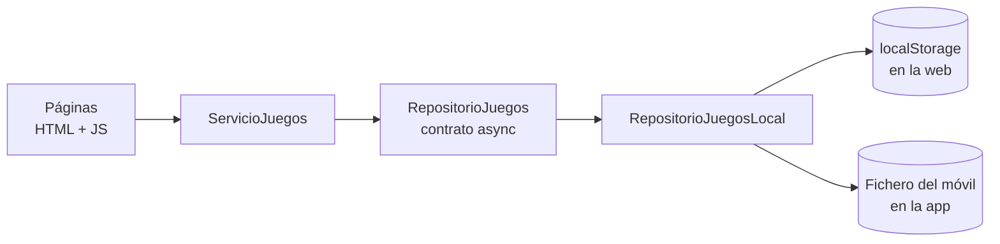

<div align="center">

# BoardGameManager

**Filtra tu colección de juegos de mesa y descubre a qué jugar hoy.**


[](LICENSE)
[](https://github.com/danielfdzperez/BoardGameManager/commits)
[-D97757?logo=claude&logoColor=white)](#ai-disclosure)

</div>

---

## ¿Qué es?

Una web (HTML/CSS/JS puro, sin dependencias ni build) y una app Android para gestionar mi colección de juegos de mesa: filtrar por jugadores, duración o dificultad, y recibir una recomendación según el grupo y el tiempo disponible. La interfaz es multiidioma (castellano e inglés).

| Página | Para qué sirve |
|---|---|
| `web/index.html` | Catálogo con filtros |
| `web/asistente.html` | «¿A qué jugamos?»: preguntas y recomendación |
| `web/crear.html` | Crear y editar juegos, copia de seguridad (exportar/importar) |

## Cómo funciona



- Los juegos viven **en tu navegador** (o en un fichero de la app), nunca en un fichero leído por la web: empieza vacía y se llena creando juegos o importando un `.json`.
- Las páginas acceden a los datos **solo** a través de la capa `web/js/datos/`; cambiar de almacén (por ejemplo a una base de datos) es tocar `fabrica.js`.
- JS clásico con scripts globales, sin módulos ES.

## Estructura del repositorio

| Carpeta | Contenido |
|---|---|
| [`web/`](web) | Todo lo publicable: HTML, `css/`, `js/` (con `js/datos/`), `i18n/` |
| [`data/`](data) | Colección maestra (`juegos.js`) y la misma lista lista para importar (`mis-juegos.json`) |
| [`capacitor/`](capacitor) | App Android (Capacitor); `www/` es una copia generada de `web/` |
| [`serverTest/`](serverTest) | Servidor local para probar la web |
| [`IADocs/`](IADocs) | Documentación técnica (en castellano) |

## Probarlo

La web se sirve por http(s); con `file://` Chrome no carga los textos JSON.

- **En internet**: GitHub Pages (ver [`IADocs/github-pages.md`](IADocs/github-pages.md)).
- **En el PC**: ejecuta `serverTest/iniciar.bat` y abre `http://localhost:8080/web/index.html`.

### Cargar tu colección
`crear.html` → **Copia de seguridad** → **Importar juegos** → elige `data/mis-juegos.json` (o cualquier copia exportada). Exporta una copia de vez en cuando: si borras los datos del sitio, se pierden.

### App Android
```bash
powershell -File capacitor/sincronizar.ps1
cd capacitor
npx cap sync android
```
Después abre `capacitor/android` en Android Studio y compila. Detalles en [`IADocs/app-android-capacitor.md`](IADocs/app-android-capacitor.md).

## Idiomas

Usa el idioma del dispositivo; en la web se cambia con el selector 🌐. Para añadir uno: copiar `web/i18n/es.json`, traducirlo y registrarlo en `web/i18n/idiomas.json` ([`IADocs/i18n.md`](IADocs/i18n.md)).

## AI disclosure

Este proyecto se ha hecho **con ayuda de IA**: [Claude](https://claude.ai) (Anthropic) se ha usado como asistente para escribir y revisar código y documentación. Las decisiones de diseño, las pruebas y la dirección del proyecto son del autor.

## Licencia

[BSD 3-Clause](LICENSE) © 2026 Daniel Fernandez
